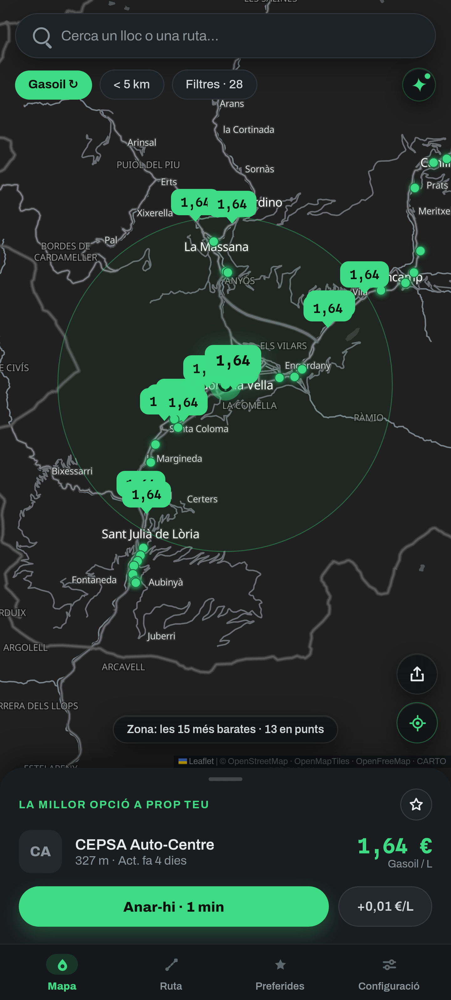
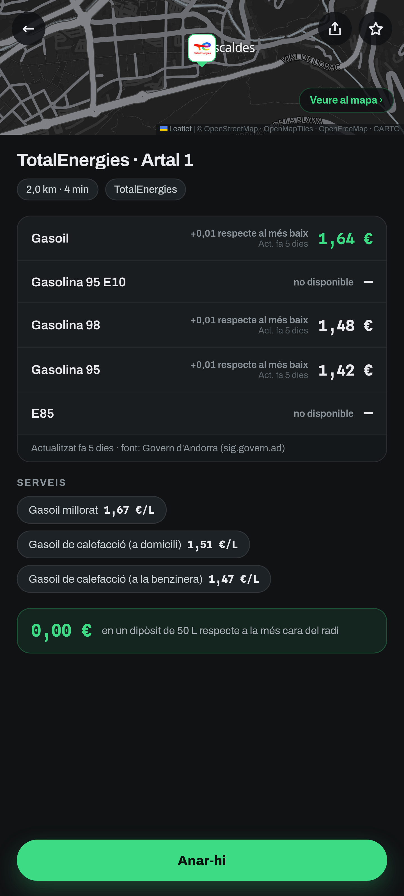
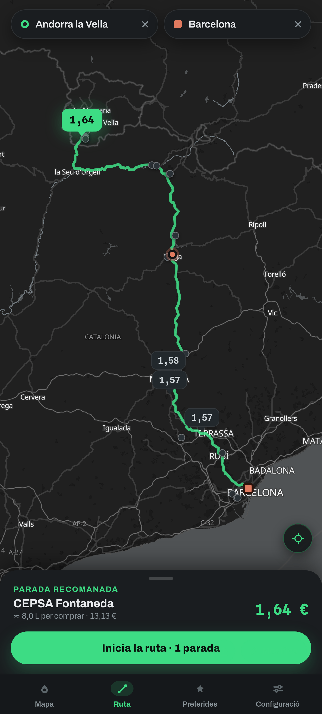
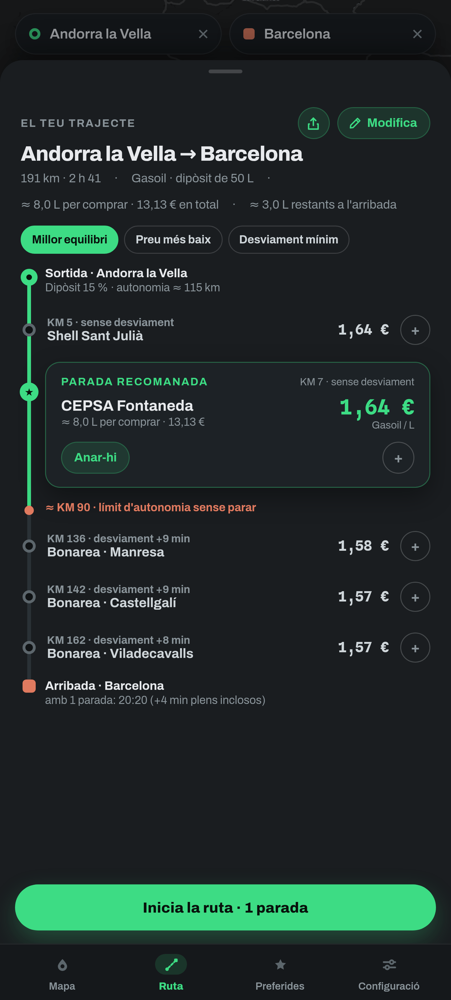

# Plein.

**El dipòsit ple al preu just** — trobeu les benzineres més barates al vostre
voltant i al llarg dels vostres trajectes, a França, Espanya, Andorra i Portugal.

[English](README.md) · [Français](README.fr.md) · [Español](README.es.md) · **Català** · [Português](README.pt.md)

 

  
  
  
  

Captures en tema fosc. També hi ha un tema clar, i el color d’accent el trieu vosaltres a Configuració › Aparença.

## ✨ Funcionalitats

- 🗺️ **Mapa de preus en directe**: les benzineres al vostre voltant, amb xinxetes acolorides de la més barata (verd) a la més cara (taronja).
- 🇫🇷🇪🇸🇦🇩🇵🇹 **Quatre països, un sol mapa**: els fluxos oficials de França, Espanya, Andorra i Portugal, perquè els proveïments a la frontera es comparin d'un cop d'ull.
- 📋 **La millor tria de debò**: el combustible cremat en el desviament també compta, i una estació més propera pot guanyar la més barata.
- 🛣️ **Un pla de proveïment per al viatge**: on parar, quants litres i a quin preu, amb tres estratègies, i quant en queda en arribar.
- 🔎 **Cerca de llocs**: ciutats, adreces i punts d'interès als quatre països.
- ⛽ **Tots els combustibles, tots els filtres**: Dièsel, SP95/98, E10, E85 i GLP, filtrats per radi, marca, serveis i AdBlue.
- 🏷️ **Marques i horaris reals**: noms i logotips de les dades oficials i d'OpenStreetMap, horaris d'obertura, sortidors esgotats i frescor dels preus.
- ⭐ **Preferides i enllaços**: les vostres estacions al preu del dia, i cada mapa o trajecte es reobre des del seu URL.
- 📱 **Arreu**: mòbil o escriptori, instal·lable i usable fora de línia, tema clar i fosc, cinc llengües.

## 🚀 Ús

1. Obriu **[plein.zadkiel.fr](https://plein.zadkiel.fr)**. Autoritzeu la ubicació, o cerqueu una ciutat.
2. Trieu el combustible: la millor tria surt primer, i **Anar-hi** l'obre a la vostra app de mapes.
3. Per a un viatge, obriu **Ruta** i introduïu la destinació. **Inicia la ruta** passa l'itinerari a Google Maps, parades per repostar incloses.
4. Al mòbil, instal·leu l'app (el bàner d'instal·lació, o Configuració › Aplicació) per tenir-la a pantalla completa i fora de línia.

Cap compte, cap rastrejador: les vostres preferides i la configuració es queden al vostre navegador.

Voleu veure què ve? [staging-plein.zadkiel.workers.dev](https://staging-plein.zadkiel.workers.dev) serveix l'últim `main` abans de publicar-se, i pot fallar.

## 📊 Fonts de dades

Cada país aporta els seus propis fluxos oficials de preus i de geocodificació, triats segons la zona que es mostra (la font *Automàtic*). El càlcul d'itineraris i el mapa base són comuns.

### 🇫🇷 França

| Dada | Font | Llicència |
| --- | --- | --- |
| Preus dels carburants i horaris | [Prix des carburants, flux en temps real](https://data.economie.gouv.fr/explore/dataset/prix-des-carburants-en-france-flux-instantane-v2/) (data.economie.gouv.fr) | Licence Ouverte / Open Licence |
| Marques de les estacions | [OpenStreetMap](https://www.openstreetmap.org/) (índex estàtic generat, aparellat amb les estacions per proximitat) | ODbL |
| Geocodificació i autocompleció | [Base Adresse Nationale](https://adresse.data.gouv.fr/), a través del servei de geocodificació de la Géoplateforme (data.geopf.fr) | Licence Ouverte / Open Licence |
| Punts d'interès (aeroports, estacions de tren, monuments…) | [Servei de geocodificació de la Géoplateforme](https://geoservices.ign.fr/documentation/services/services-geoplateforme/geocodage) (data.geopf.fr, BD TOPO de l'IGN) | Licence Ouverte / Open Licence |
| Geocodificació de reserva, quan la Géoplateforme no respon | [Photon](https://photon.komoot.io) (instància pública de Komoot, índex OpenStreetMap), limitat a la França metropolitana | ODbL |

### 🇪🇸 Espanya

| Dada | Font | Llicència |
| --- | --- | --- |
| Preus dels carburants, horaris i marques | [Precios de carburantes](https://geoportalgasolineras.es) (sedeaplicaciones.minetur.gob.es, MITECO); la marca (*rótulo*) l'aporta el flux | Datos abiertos |
| Geocodificació i autocompleció | [CartoCiudad](https://www.cartociudad.es) (IGN) | CC BY 4.0 |
| Geocodificació de reserva, quan CartoCiudad no respon | [Photon](https://photon.komoot.io), limitat a l'Espanya peninsular i les Balears | ODbL |

### 🇦🇩 Andorra

| Dada | Font | Llicència |
| --- | --- | --- |
| Preus dels carburants i marques | [Preus dels carburants](https://sig.govern.ad/IPE/PreusCarburants) (sig.govern.ad, Govern d'Andorra, Oficina de l'Energia i del Canvi Climàtic); la marca surt del nom de l'estació, i el flux no porta ni adreça ni horaris | © Govern d'Andorra |
| Geocodificació i autocompleció | Nomenclàtor (nomenclàtor oficial) i LocatorIDE (sig.govern.ad, IDE Andorra) | © Govern d'Andorra |
| Geocodificació de reserva, quan els localitzadors de la IDE no responen | [Photon](https://photon.komoot.io), limitat a Andorra | ODbL |

### 🇵🇹 Portugal

| Dada | Font | Llicència |
| --- | --- | --- |
| Preus dels carburants i marques | [Preços dos combustíveis](https://precoscombustiveis.dgeg.gov.pt) (DGEG, Direção-Geral de Energia e Geologia); el flux aporta la marca (*marca*) però no els horaris ni l'E10, i només cobreix el continent (les Açores i Madeira tenen el seu propi règim) | Dados abertos |
| Geocodificació i autocompleció | [Photon](https://photon.komoot.io) (instància pública de Komoot, índex OpenStreetMap), limitat al Portugal continental (el país no publica cap geocodificador d'adreces sense clau) | ODbL |

### Comuns als quatre països

| Dada | Font | Llicència |
| --- | --- | --- |
| Càlcul d'itineraris | [OSRM](https://project-osrm.org/) (servidor de demostració) · [Valhalla](https://valhalla.github.io/valhalla/) (servidor públic FOSSGIS) per a «evitar autopistes / peatges» | © col·laboradors d'[OpenStreetMap](https://www.openstreetmap.org/copyright) |
| Mapes base | Tessel·les vectorials d'[OpenFreeMap](https://openfreemap.org), sense clau d'API, estil Positron / Dark Matter segons el tema (tessel·les ràster d'OpenStreetMap com a recurs si OpenFreeMap no respon o el dispositiu no té WebGL) | © [OpenMapTiles](https://openmaptiles.org) · © col·laboradors d'[OpenStreetMap](https://www.openstreetmap.org/copyright) · colors de l'estil fosc © [CARTO](https://carto.com/attributions) (CC BY 4.0) |

L'app no té **cap backend**: el navegador consulta directament aquests serveis públics. Sense connexió o amb un flux caigut, conserva les últimes estacions carregades amb un bàner que ho indica, i ho torna a provar quan torna la connexió. Quan el geocodificador d'un país no respon, Photon el substitueix; si també falla, la cerca indica quins països falten.

## 🛠️ Construït amb

**Vite · React 18 · TypeScript estricte · Leaflet**, més MapLibre GL per al mapa base vectorial (carregat sota demanda). La compilació de producció són recursos estàtics servits per un Cloudflare Worker.

## 🤝 Contribuir

Els informes d'errors, les traduccions i les pull requests són benvinguts: [CONTRIBUTING.md](CONTRIBUTING.md) (en anglès) explica la instal·lació, les ordres, les regles de la casa i les proves. Per informar d'un error, adjunteu la instantània de depuració: Configuració › Dades sense connexió › Superposició de depuració, i després la pastilla flotant **DBG** › **Report**, que la copia i obre el formulari.

## 📄 Llicència

Codi sota llicència [MIT](LICENSE) © Zadkiel Aharonian. Les dades mostrades continuen subjectes a les llicències dels seus productors (Licence Ouverte per a les dades públiques franceses, datos abiertos del MITECO per als preus espanyols, © Govern d'Andorra per a Andorra, dados abertos de la DGEG per als preus portuguesos, ODbL per a OpenStreetMap). Les tipografies **Archivo** i **Spline Sans Mono** de `public/fonts/` estan sota la [SIL Open Font License 1.1](public/fonts/) (vegeu-hi els fitxers `*-OFL.txt`).
