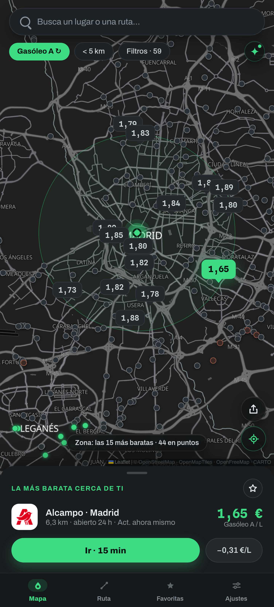
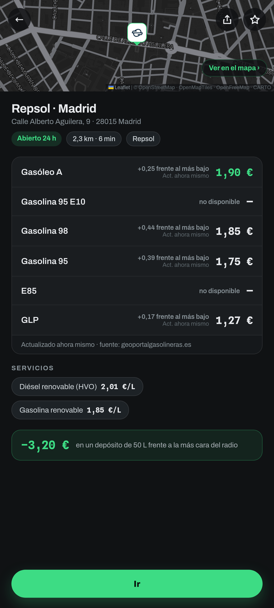
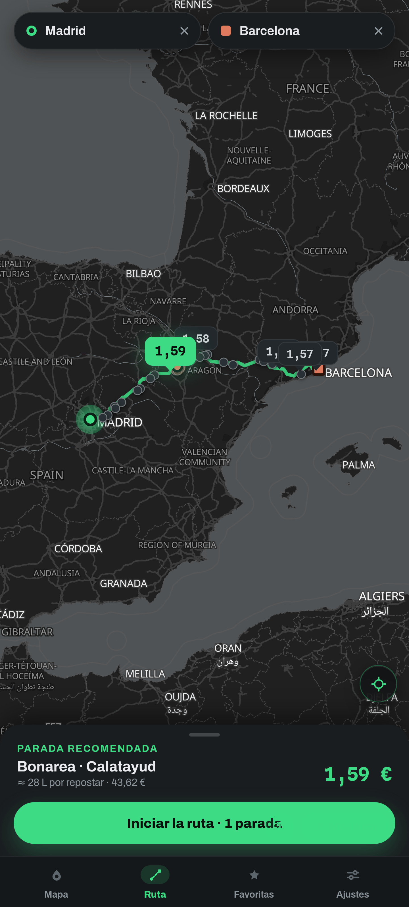
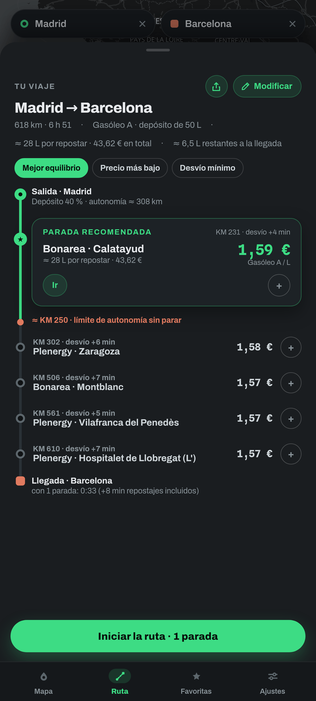

# Plein.

**El depósito lleno al precio justo** — encuentra las gasolineras más baratas
a tu alrededor y a lo largo de tus rutas, en Francia, España, Andorra y Portugal.

[English](README.md) · [Français](README.fr.md) · **Español** · [Català](README.ca.md) · [Português](README.pt.md)

 

  
  
  
  

Capturas en tema oscuro. También hay un tema claro, y el color de acento lo eliges tú en Ajustes › Apariencia.

## ✨ Funcionalidades

- 🗺️ **Mapa de precios en directo**: las estaciones a tu alrededor, con chinchetas coloreadas de la más barata (verde) a la más cara (naranja).
- 🇫🇷🇪🇸🇦🇩🇵🇹 **Cuatro países, un solo mapa**: los flujos oficiales de Francia, España, Andorra y Portugal, para comparar de un vistazo los repostajes en la frontera.
- 📋 **La mejor elección real**: el combustible gastado en el desvío cuenta, así que una estación más cercana puede ganar a la más barata.
- 🛣️ **Un plan de repostaje para tu viaje**: dónde parar, cuántos litros, a qué precio y cuánto te queda al llegar.
- 🔎 **Búsqueda de lugares**: ciudades, direcciones y puntos de interés en los cuatro países.
- ⛽ **Todos los combustibles, horarios reales**: Diésel, SP95/98, E10, E85, GLP y AdBlue, con horarios de apertura, surtidores sin existencias y la antigüedad de los precios.
- ⭐ **Favoritos y enlaces**: tus estaciones al precio del día, y cada mapa o ruta se vuelve a abrir desde su URL.
- 📱 **En cualquier parte**: móvil o escritorio, instalable y utilizable sin conexión, tema claro y oscuro, cinco idiomas.

## 🚀 Uso

1. Abre **[plein.zadkiel.fr](https://plein.zadkiel.fr)**. Permite la ubicación o busca una ciudad.
2. Elige tu combustible: la mejor elección aparece primero, e **Ir** la abre en tu app de mapas.
3. Para un viaje, abre **Ruta** e introduce el destino. **Iniciar la ruta** pasa el itinerario, paradas de repostaje incluidas, a Google Maps.
4. En el móvil, instala la app (con el banner de instalación o en Ajustes › Aplicación) para tenerla a pantalla completa y sin conexión.

Sin cuenta, sin rastreadores: tus favoritos y ajustes se quedan en tu navegador.

¿Quieres ver lo que viene? [staging-plein.zadkiel.workers.dev](https://staging-plein.zadkiel.workers.dev) sirve el último `main` antes de publicarse, y puede fallar.

## 📊 Fuentes de datos

Cada país aporta sus propios flujos oficiales de precios y geocodificación, elegidos según la zona mostrada en pantalla (la fuente *Automático*). El cálculo de rutas y el mapa base son comunes.

### 🇫🇷 Francia

| Dato | Fuente | Licencia |
| --- | --- | --- |
| Precios de los carburantes y horarios | [Prix des carburants, flujo en tiempo real](https://data.economie.gouv.fr/explore/dataset/prix-des-carburants-en-france-flux-instantane-v2/) (data.economie.gouv.fr) | Licence Ouverte / Open Licence |
| Rótulos de las estaciones | [OpenStreetMap](https://www.openstreetmap.org/) (índice estático generado, emparejado con las estaciones por proximidad) | ODbL |
| Geocodificación y autocompletado | [Base Adresse Nationale](https://adresse.data.gouv.fr/), a través del servicio de geocodificación de la Géoplateforme (data.geopf.fr) | Licence Ouverte / Open Licence |
| Puntos de interés (aeropuertos, estaciones de tren, monumentos…) | [Servicio de geocodificación de la Géoplateforme](https://geoservices.ign.fr/documentation/services/services-geoplateforme/geocodage) (data.geopf.fr, BD TOPO del IGN) | Licence Ouverte / Open Licence |
| Geocodificación de respaldo, cuando la Géoplateforme no responde | [Photon](https://photon.komoot.io) (instancia pública de Komoot, índice OpenStreetMap), limitado a la Francia metropolitana | ODbL |

### 🇪🇸 España

| Dato | Fuente | Licencia |
| --- | --- | --- |
| Precios de carburantes, horarios y rótulos | [Precios de carburantes](https://geoportalgasolineras.es) (sedeaplicaciones.minetur.gob.es, MITECO); el flujo incluye el rótulo | Datos abiertos |
| Geocodificación y autocompletado | [CartoCiudad](https://www.cartociudad.es) (IGN) | CC BY 4.0 |
| Geocodificación de respaldo, cuando CartoCiudad no responde | [Photon](https://photon.komoot.io), limitado a la España peninsular y Baleares | ODbL |

### 🇦🇩 Andorra

| Dato | Fuente | Licencia |
| --- | --- | --- |
| Precios de carburantes y marcas | [Preus dels carburants](https://sig.govern.ad/IPE/PreusCarburants) (sig.govern.ad, Govern d'Andorra, Oficina de l'Energia i del Canvi Climàtic); la marca se deduce del nombre de la estación, y el flujo no incluye dirección ni horarios | © Govern d'Andorra |
| Geocodificación y autocompletado | Nomenclàtor (nomenclátor oficial) & LocatorIDE (sig.govern.ad, IDE Andorra) | © Govern d'Andorra |
| Geocodificación de respaldo, cuando los localizadores de la IDE no responden | [Photon](https://photon.komoot.io), limitado a Andorra | ODbL |

### 🇵🇹 Portugal

| Dato | Fuente | Licencia |
| --- | --- | --- |
| Precios de carburantes y marcas | [Preços dos combustíveis](https://precoscombustiveis.dgeg.gov.pt) (DGEG, Direção-Geral de Energia e Geologia); el flujo incluye la marca (*marca*) pero no los horarios ni el E10, y solo cubre el territorio continental (las Azores y Madeira tienen su propio régimen) | Dados abertos |
| Geocodificación y autocompletado | [Photon](https://photon.komoot.io) (instancia pública de Komoot, índice OpenStreetMap), limitado al Portugal continental (el país no publica ningún geocodificador de direcciones sin clave) | ODbL |

### Comunes a los cuatro países

| Dato | Fuente | Licencia |
| --- | --- | --- |
| Cálculo de rutas | [OSRM](https://project-osrm.org/) (servidor de demostración) · [Valhalla](https://valhalla.github.io/valhalla/) (servidor público FOSSGIS) para «evitar autopistas / peajes» | © colaboradores de [OpenStreetMap](https://www.openstreetmap.org/copyright) |
| Mapas base | Teselas vectoriales de [OpenFreeMap](https://openfreemap.org), sin clave de API, estilo Positron / Dark Matter según el tema (teselas ráster de OpenStreetMap como respaldo si OpenFreeMap no responde o el dispositivo no tiene WebGL) | © [OpenMapTiles](https://openmaptiles.org) · © colaboradores de [OpenStreetMap](https://www.openstreetmap.org/copyright) · colores del estilo oscuro © [CARTO](https://carto.com/attributions) (CC BY 4.0) |

La app no tiene **ningún backend**: el navegador consulta directamente estos servicios públicos. Sin conexión o con un flujo caído, conserva las últimas estaciones cargadas con un banner que lo indica, y reintenta en cuanto vuelve la conexión. Cuando el geocodificador de un país no responde, Photon lo sustituye; si también falla, la búsqueda indica qué países faltan.

## 🛠️ Construido con

**Vite · React 18 · TypeScript estricto · Leaflet**, más MapLibre GL para el mapa base vectorial (cargado bajo demanda). La compilación de producción son recursos estáticos servidos por un Cloudflare Worker.

## 🤝 Contribuir

Los informes de errores, las traducciones y las pull requests son bienvenidos: [CONTRIBUTING.md](CONTRIBUTING.md) (en inglés) explica la instalación, los comandos, las reglas de la casa y las pruebas. Al informar de un error, incluye la instantánea de depuración: Ajustes › Datos sin conexión › Superposición de depuración, y luego la pastilla flotante **DBG** › **Report**, que la copia y abre el formulario.

## 📄 Licencia

Código bajo licencia [MIT](LICENSE) © Zadkiel Aharonian. Los datos mostrados siguen sujetos a las licencias de sus productores (Licence Ouverte para los datos públicos franceses, datos abiertos del MITECO para los precios españoles, © Govern d'Andorra para Andorra, dados abertos de la DGEG para los precios portugueses, ODbL para OpenStreetMap). Las tipografías **Archivo** y **Spline Sans Mono** de `public/fonts/` están bajo la [SIL Open Font License 1.1](public/fonts/) (ver los archivos `*-OFL.txt` de esa carpeta).
