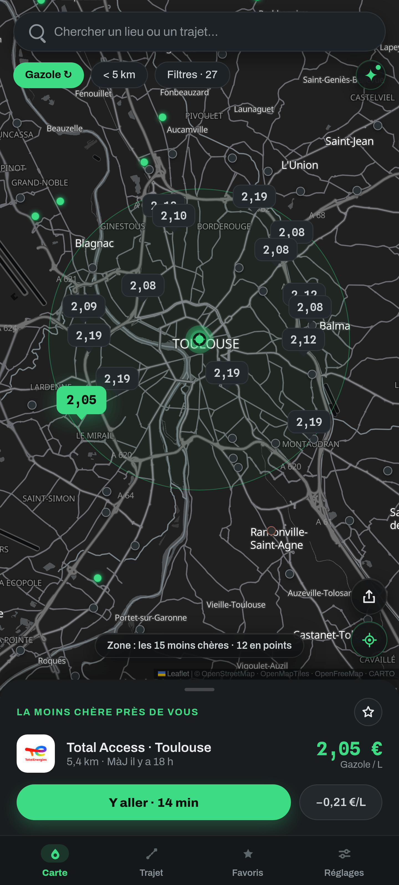
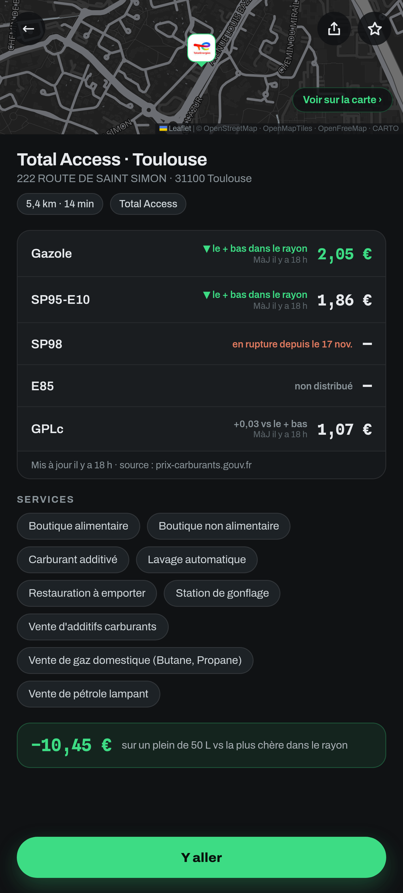
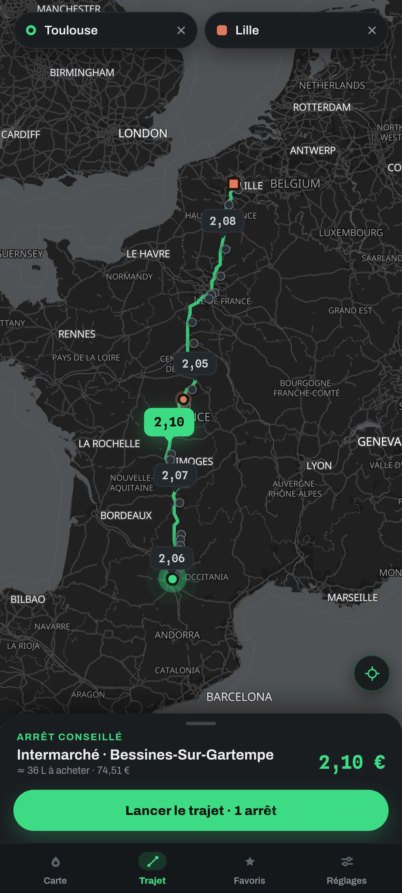
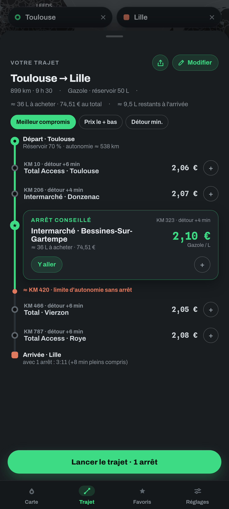

# Plein.

**Le plein au juste prix** — trouvez les stations-service les moins chères
autour de vous et le long de vos trajets, en France, en Espagne, en Andorre et au Portugal.

[English](README.md) · **Français** · [Español](README.es.md) · [Català](README.ca.md) · [Português](README.pt.md)

 

  
  
  
  

Captures en thème sombre. Il existe aussi un thème clair, et la couleur d'accent se choisit dans Réglages › Apparence.

## ✨ Fonctionnalités

- 🗺️ **Carte des prix en direct** : les stations autour de vous, pins colorés de la moins chère (vert) à la plus chère (orange).
- 🇫🇷🇪🇸🇦🇩🇵🇹 **Quatre pays, une seule carte** : les flux officiels de la France, de l'Espagne, de l'Andorre et du Portugal, pour comparer d'un coup d'œil les pleins de part et d'autre de la frontière.
- 📋 **Le vrai meilleur choix** : le carburant brûlé pour le détour est compté, si bien qu'une station plus proche peut battre la moins chère.
- 🛣️ **Un plan carburant pour votre trajet** : où s'arrêter, combien de litres, pour quel prix, et ce qu'il reste dans le réservoir à l'arrivée.
- 🔎 **Recherche de lieux** : villes, adresses et points d'intérêt dans les quatre pays.
- ⛽ **Tous les carburants, les vrais horaires** : Gazole, SP95/98, E10, E85, GPLc et AdBlue, avec les horaires d'ouverture, les pompes en rupture et la fraîcheur des prix.
- ⭐ **Favoris et liens** : vos stations au prix du jour, et chaque carte ou trajet se rouvre depuis son adresse.
- 📱 **Partout** : téléphone ou ordinateur, installable et utilisable hors-ligne, thèmes clair et sombre, cinq langues.

## 🚀 Utilisation

1. Ouvrez **[plein.zadkiel.fr](https://plein.zadkiel.fr)**. Autorisez la géolocalisation, ou cherchez une ville.
2. Choisissez votre carburant : le meilleur choix arrive en tête, et **Y aller** l'ouvre dans votre app de navigation.
3. Pour un long trajet, ouvrez l'onglet **Trajet** et saisissez la destination. **Lancer le trajet** confie l'itinéraire, arrêts carburant compris, à Google Maps.
4. Sur téléphone, installez l'app (la bannière d'installation, ou Réglages › Application) pour l'avoir en plein écran et hors-ligne.

Aucun compte, aucun tracker : vos favoris et réglages restent dans votre navigateur.

Envie de voir la suite ? [staging-plein.zadkiel.workers.dev](https://staging-plein.zadkiel.workers.dev) sert le dernier `main` avant sa mise en production, et peut casser.

## 📊 Sources de données

Chaque pays apporte ses propres flux officiels pour les prix et le géocodage, choisis selon la zone affichée (la source *Automatique*). Les itinéraires et le fond de carte sont communs.

### 🇫🇷 France

| Donnée | Source | Licence |
| --- | --- | --- |
| Prix des carburants & horaires | [Prix des carburants, flux temps réel](https://data.economie.gouv.fr/explore/dataset/prix-des-carburants-en-france-flux-instantane-v2/) (data.economie.gouv.fr) | Licence Ouverte / Open Licence |
| Enseignes des stations | [OpenStreetMap](https://www.openstreetmap.org/) (index statique généré, rapproché des stations par proximité) | ODbL |
| Géocodage & autocomplétion | [Base Adresse Nationale](https://adresse.data.gouv.fr/), via le service de géocodage de la Géoplateforme (data.geopf.fr) | Licence Ouverte / Open Licence |
| Points d'intérêt (aéroports, gares, monuments…) | [Service de géocodage de la Géoplateforme](https://geoservices.ign.fr/documentation/services/services-geoplateforme/geocodage) (data.geopf.fr, BD TOPO de l'IGN) | Licence Ouverte / Open Licence |
| Géocodage de secours, quand la Géoplateforme ne répond pas | [Photon](https://photon.komoot.io) (instance publique Komoot, index OpenStreetMap), borné à la France métropolitaine | ODbL |

### 🇪🇸 Espagne

| Donnée | Source | Licence |
| --- | --- | --- |
| Prix des carburants, horaires & enseignes | [Precios de carburantes](https://geoportalgasolineras.es) (sedeaplicaciones.minetur.gob.es, MITECO) ; l'enseigne (*rótulo*) est portée par le flux | Datos abiertos |
| Géocodage & autocomplétion | [CartoCiudad](https://www.cartociudad.es) (IGN) | CC BY 4.0 |
| Géocodage de secours, quand CartoCiudad ne répond pas | [Photon](https://photon.komoot.io), borné à l'Espagne continentale et aux Baléares | ODbL |

### 🇦🇩 Andorre

| Donnée | Source | Licence |
| --- | --- | --- |
| Prix des carburants & enseignes | [Preus dels carburants](https://sig.govern.ad/IPE/PreusCarburants) (sig.govern.ad, Govern d'Andorra, Oficina de l'Energia i del Canvi Climàtic) ; l'enseigne est déduite du nom de la station, et le flux ne porte ni adresse ni horaires | © Govern d'Andorra |
| Géocodage & autocomplétion | Nomenclàtor (gazetteer officiel) & LocatorIDE (sig.govern.ad, IDE Andorra) | © Govern d'Andorra |
| Géocodage de secours, quand les localisateurs de l'IDE ne répondent pas | [Photon](https://photon.komoot.io), borné à l'Andorre | ODbL |

### 🇵🇹 Portugal

| Donnée | Source | Licence |
| --- | --- | --- |
| Prix des carburants & enseignes | [Preços dos combustíveis](https://precoscombustiveis.dgeg.gov.pt) (DGEG, Direção-Geral de Energia e Geologia) ; le flux porte l'enseigne (*marca*) mais ni horaires ni E10, et ne couvre que le continent (les Açores et Madère ont leur propre régime) | Dados abertos |
| Géocodage & autocomplétion | [Photon](https://photon.komoot.io) (instance publique Komoot, index OpenStreetMap), borné au Portugal continental (le pays ne publie pas de géocodeur d'adresses sans clé) | ODbL |

### Communs aux quatre pays

| Donnée | Source | Licence |
| --- | --- | --- |
| Calcul d'itinéraires | [OSRM](https://project-osrm.org/) (serveur démo) · [Valhalla](https://valhalla.github.io/valhalla/) (serveur public FOSSGIS) pour « éviter autoroutes / péages » | © contributeurs [OpenStreetMap](https://www.openstreetmap.org/copyright) |
| Fonds de carte | Tuiles vectorielles [OpenFreeMap](https://openfreemap.org), sans clé d'API, style Positron / Dark Matter selon le thème (tuiles raster OpenStreetMap en secours si OpenFreeMap est injoignable ou si l'appareil n'a pas WebGL) | © [OpenMapTiles](https://openmaptiles.org) · © contributeurs [OpenStreetMap](https://www.openstreetmap.org/copyright) · couleurs du style sombre © [CARTO](https://carto.com/attributions) (CC BY 4.0) |

L'app n'a **aucun backend** : le navigateur interroge directement ces services publics. Hors connexion ou quand un flux est indisponible, elle garde les dernières stations chargées avec une bannière qui le signale, et réessaie dès que la connexion revient. Quand le géocodeur d'un pays ne répond pas, Photon prend le relais ; s'il échoue aussi, la recherche indique quels pays manquent.

## 🛠️ Construit avec

**Vite · React 18 · TypeScript strict · Leaflet**, plus MapLibre GL pour le fond de carte vectoriel (chargé à la demande). Le build de production n'est que des assets statiques, servis par un Cloudflare Worker.

## 🤝 Contribuer

Signalements, traductions et pull requests sont les bienvenus : [CONTRIBUTING.md](CONTRIBUTING.md) (en anglais) détaille l'installation, les commandes, les règles de la maison et les tests. Pour signaler un bug, joignez le snapshot de débogage : Réglages › Données hors ligne › Overlay de débogage, puis la pastille flottante **DBG** › **Report**, qui le copie et ouvre le formulaire.

## 📄 Licence

Code sous licence [MIT](LICENSE) © Zadkiel Aharonian. Les données affichées restent soumises aux licences de leurs producteurs (Licence Ouverte pour les données publiques françaises, datos abiertos du MITECO pour les prix espagnols, © Govern d'Andorra pour l'Andorre, dados abertos de la DGEG pour les prix portugais, ODbL pour OpenStreetMap). Les polices **Archivo** et **Spline Sans Mono** de `public/fonts/` sont sous [SIL Open Font License 1.1](public/fonts/) (voir les fichiers `*-OFL.txt` du même dossier).
