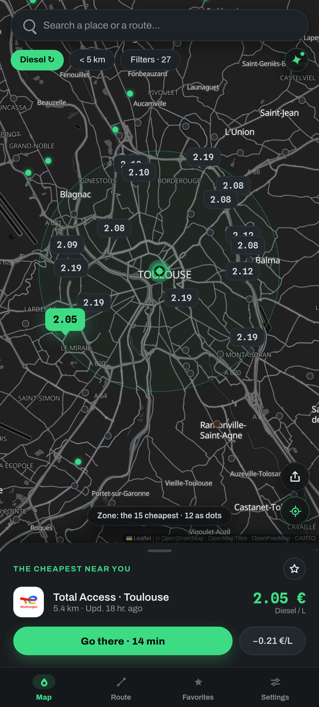
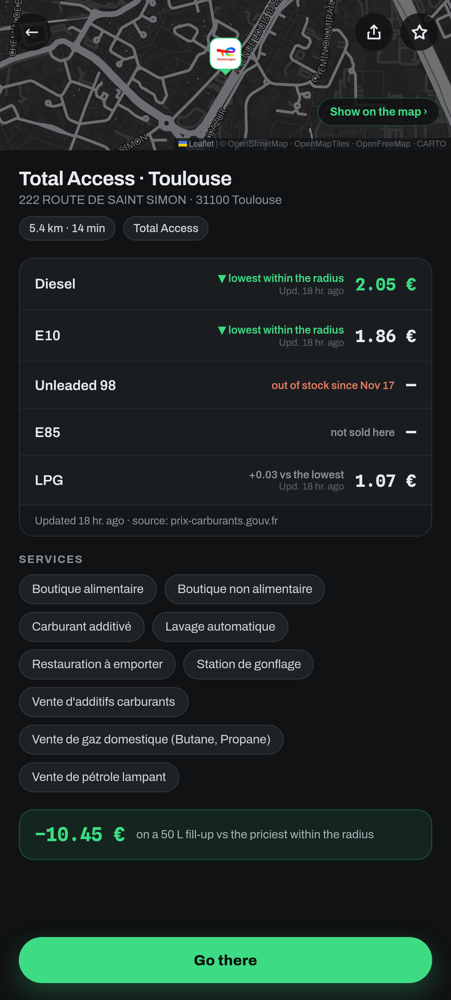
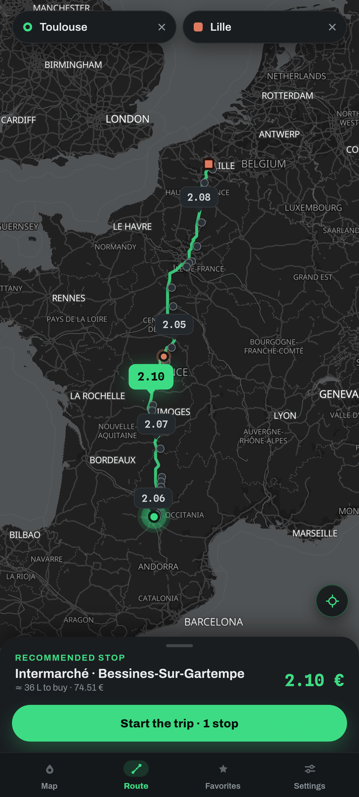
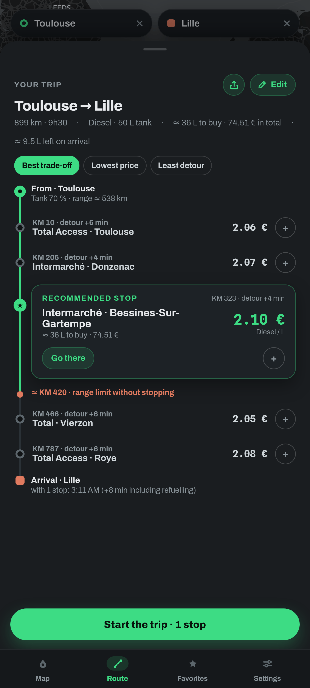

# Plein.

**A full tank at the right price** — find the cheapest fuel stations around
you and along your routes, in France, Spain, Andorra and Portugal.

**English** · [Français](README.fr.md) · [Español](README.es.md) · [Català](README.ca.md) · [Português](README.pt.md)

 

  
  
  
  

Shown in the dark theme. There is a light theme too, and the accent color is yours to pick in Settings › Appearance.

## ✨ Features

- 🗺️ **Live price map**: the stations around you, pins colored from the cheapest (green) to the priciest (orange).
- 🇫🇷🇪🇸🇦🇩🇵🇹 **Four countries, one map**: the official feeds of France, Spain, Andorra and Portugal, so border fill-ups compare at a glance.
- 📋 **The real best choice**: the fuel burned on the detour counts, so a closer station can beat the cheapest one.
- 🛣️ **A fuel plan for your trip**: where to stop, how many liters and at what cost, under three strategies, and how much is left on arrival.
- 🔎 **Place search**: towns, addresses and points of interest across the four countries.
- ⛽ **Every fuel, every filter**: Diesel, SP95/98, E10, E85 and LPG, filtered by radius, brand, services and AdBlue.
- 🏷️ **Real brands and hours**: names and logos from the official feeds and OpenStreetMap, opening hours, out-of-stock pumps and price freshness.
- ⭐ **Favorites and links**: your stations at today's price, and every map or route reopens from its URL.
- 📱 **Anywhere**: phone or desktop, installable and usable offline, light and dark themes, five languages.

## 🚀 Usage

1. Open **[plein.zadkiel.fr](https://plein.zadkiel.fr)**. Allow location, or search for a town.
2. Pick your fuel: the best choice comes first, and **Go there** opens it in your maps app.
3. For a trip, open **Route** and enter the destination. **Start the trip** hands the itinerary, fuel stops included, to Google Maps.
4. On a phone, install the app (the install banner, or Settings › App) to get it full screen and offline.

No account, no tracker: your favorites and settings stay in your browser.

Want what is coming next? [staging-plein.zadkiel.workers.dev](https://staging-plein.zadkiel.workers.dev) runs the latest `main` before it is released, and may break.

## 📊 Data sources

Each country brings its own official feeds for prices and geocoding, picked from the area on screen (the *Automatic* source). Routing and the basemap are shared.

### 🇫🇷 France

| Data | Source | License |
| --- | --- | --- |
| Fuel prices & opening hours | [Prix des carburants, real-time feed](https://data.economie.gouv.fr/explore/dataset/prix-des-carburants-en-france-flux-instantane-v2/) (data.economie.gouv.fr) | Licence Ouverte / Open Licence |
| Station brands | [OpenStreetMap](https://www.openstreetmap.org/) (generated static index, matched to stations by proximity) | ODbL |
| Geocoding & autocompletion | [Base Adresse Nationale](https://adresse.data.gouv.fr/), through the Géoplateforme geocoding service (data.geopf.fr) | Licence Ouverte / Open Licence |
| Points of interest (airports, railway stations, monuments…) | [Géoplateforme geocoding service](https://geoservices.ign.fr/documentation/services/services-geoplateforme/geocodage) (data.geopf.fr, IGN BD TOPO) | Licence Ouverte / Open Licence |
| Backup geocoding, when the Géoplateforme does not answer | [Photon](https://photon.komoot.io) (public Komoot instance, OpenStreetMap index), bounded to metropolitan France | ODbL |

### 🇪🇸 Spain

| Data | Source | License |
| --- | --- | --- |
| Fuel prices, hours & brands | [Precios de carburantes](https://geoportalgasolineras.es) (sedeaplicaciones.minetur.gob.es, MITECO); the feed carries the brand (*rótulo*) | Datos abiertos |
| Geocoding & autocompletion | [CartoCiudad](https://www.cartociudad.es) (IGN) | CC BY 4.0 |
| Backup geocoding, when CartoCiudad does not answer | [Photon](https://photon.komoot.io), bounded to mainland Spain and the Balearics | ODbL |

### 🇦🇩 Andorra

| Data | Source | License |
| --- | --- | --- |
| Fuel prices & brands | [Preus dels carburants](https://sig.govern.ad/IPE/PreusCarburants) (sig.govern.ad, Govern d'Andorra, Oficina de l'Energia i del Canvi Climàtic); the brand comes from the station name, and the feed has no address or opening hours | © Govern d'Andorra |
| Geocoding & autocompletion | Nomenclàtor (official gazetteer) & LocatorIDE (sig.govern.ad, IDE Andorra) | © Govern d'Andorra |
| Backup geocoding, when the IDE locators do not answer | [Photon](https://photon.komoot.io), bounded to Andorra | ODbL |

### 🇵🇹 Portugal

| Data | Source | License |
| --- | --- | --- |
| Fuel prices & brands | [Preços dos combustíveis](https://precoscombustiveis.dgeg.gov.pt) (DGEG, Direção-Geral de Energia e Geologia); the feed carries the brand (*marca*) but no opening hours or E10, and covers the mainland only (the Azores and Madeira have their own regime) | Dados abertos |
| Geocoding & autocompletion | [Photon](https://photon.komoot.io) (public Komoot instance, OpenStreetMap index), bounded to mainland Portugal (the country publishes no keyless address geocoder) | ODbL |

### Shared by all four countries

| Data | Source | License |
| --- | --- | --- |
| Routing | [OSRM](https://project-osrm.org/) (demo server) · [Valhalla](https://valhalla.github.io/valhalla/) (public FOSSGIS server) for "avoid motorways / tolls" | © [OpenStreetMap](https://www.openstreetmap.org/copyright) contributors |
| Basemaps | [OpenFreeMap](https://openfreemap.org) vector tiles, no API key, Positron / Dark Matter style following the theme (OpenStreetMap raster tiles as fallback when OpenFreeMap is unreachable or the device has no WebGL) | © [OpenMapTiles](https://openmaptiles.org) · © [OpenStreetMap](https://www.openstreetmap.org/copyright) contributors · dark style colors © [CARTO](https://carto.com/attributions) (CC BY 4.0) |

The app has **no backend**: the browser queries these public services directly. Offline or when a feed is down, it keeps the last loaded stations with a banner saying so, and retries once the connection returns. When a country's geocoder does not answer, Photon stands in; if that fails too, the search says which countries are missing.

## 🛠️ Built with

**Vite · React 18 · strict TypeScript · Leaflet**, plus MapLibre GL for the vector basemap (loaded on demand). The production build is static assets served by a Cloudflare Worker.

## 🤝 Contributing

Bug reports, translations and pull requests are welcome: [CONTRIBUTING.md](CONTRIBUTING.md) covers the setup, the commands, the house rules and the tests. When reporting a bug, include the debug snapshot: Settings › Offline data › Debug overlay, then the floating **DBG** chip › **Report**, which copies it and opens the form.

## 📄 License

Code under the [MIT](LICENSE) license © Zadkiel Aharonian. The data shown stays under its producers' licenses (Licence Ouverte for French public data, MITECO datos abiertos for Spanish prices, © Govern d'Andorra for Andorra, DGEG dados abertos for Portuguese prices, ODbL for OpenStreetMap). The **Archivo** and **Spline Sans Mono** fonts in `public/fonts/` are under the [SIL Open Font License 1.1](public/fonts/) (see the `*-OFL.txt` files there).
