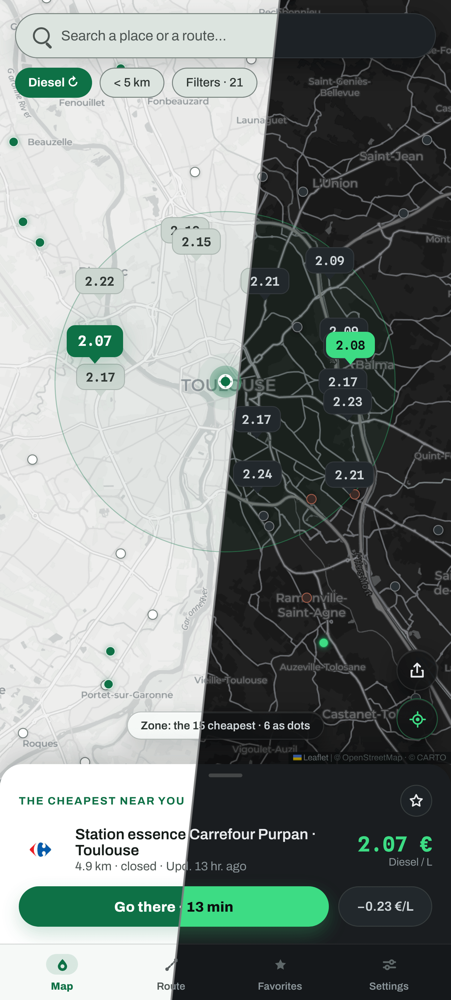
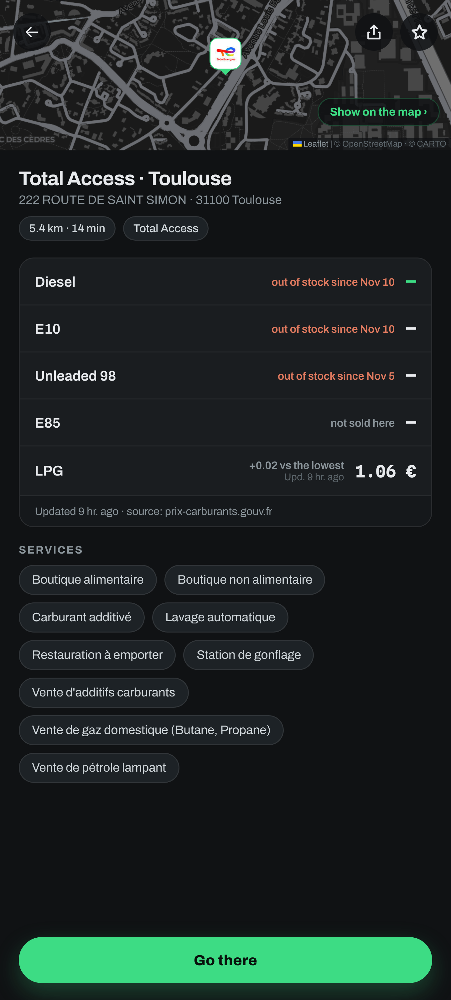
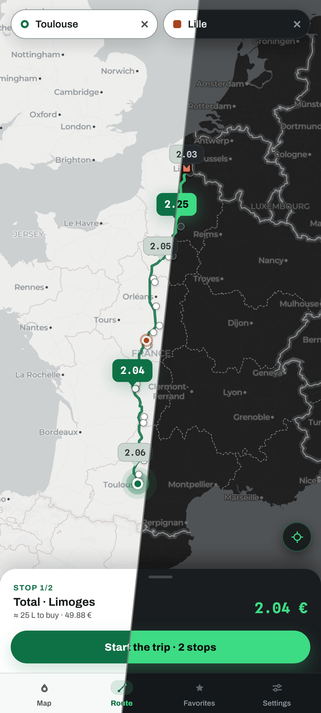
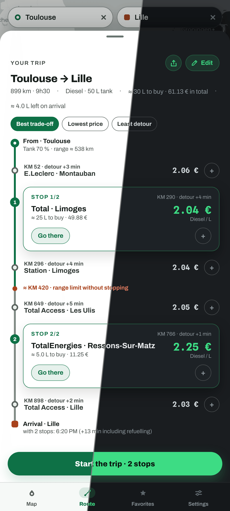

# Plein.

**A full tank at the right price** — find the cheapest fuel stations around
you and along your routes, in France, Spain, Andorra and Portugal.

**English** · [Français](README.fr.md) · [Español](README.es.md) · [Català](README.ca.md) · [Português](README.pt.md)

Want what is coming next? [staging-plein.zadkiel.workers.dev](https://staging-plein.zadkiel.workers.dev) runs the latest `main`, before it is released — it may break.

 

  
  
  
  

Shown in the dark theme. There is a light theme too, and the accent color is yours to pick in Settings › Appearance.

## ✨ Features

- 🗺️ **Live price map** — stations around you, price pins colored by price:
  good deals in green, the priciest in orange.
- 🇫🇷🇪🇸🇦🇩🇵🇹 **Four countries on one map** — the official feeds of France,
  Spain, Andorra and Portugal combined; border fill-ups compare at a glance.
- 🔎 **Place search** — towns, addresses and points of interest (railway
  stations, airports, monuments) across the four countries, ranked by how
  well they match what you typed, the country on the map first.
- 📋 **Real best choice** — the fuel burned for the detour is counted, so a
  closer station can beat the cheapest one.
- 🛣️ **Route fuel plan** — where to stop along your trip, how many liters at
  each stop and at what cost, under 3 strategies.
- ⭐ **Favorites** — your stations and their day's price, across areas and
  countries.
- ⛽ **All fuels** — Diesel, SP95/98, E10, E85, LPG; filters by radius,
  brands, services and AdBlue.
- 🕐 **Real opening hours** — "Open 24/7", "Closed · opens at 6:30 am" — with
  price freshness flagged.
- 🚫 **Shortages flagged** — a dry pump reads "out of stock since Nov 3"
  instead of "not sold here", and an area counts its dry stations (France).
- 🏷️ **Recognized brands** — station names and logos from the official feeds
  and OpenStreetMap.
- 🧭 **Directions** — opens the station in your GPS app.
- 🔗 **Shareable links** — the URL follows the map and the route; a link
  reopens the same view.
- 🌗 **Light and dark themes** — follows your browser, switchable in Settings,
  with a choice of accent color (green, turquoise, blue or violet).
- 🌍 **Five languages** — French, English, Spanish, Catalan and Portuguese.
- 🖥️ **Phone and desktop** — full-screen map and sheet on mobile, side panels
  on a wide screen.
- 📱 **Installable PWA** — the last areas and tiles work offline.

## 🚀 Usage

1. Open **[plein.zadkiel.fr](https://plein.zadkiel.fr)** (the official deployment).
2. Allow geolocation — or continue without it, and search for a city in
   France, Spain, Andorra or Portugal. The search remembers the places you
   picked there: it offers them as soon as it opens and ranks them at the top
   of the suggestions as soon as you type.
3. Pick your fuel at the top of the map: the best choice (price AND distance,
   detour counted) shows up in the bottom sheet, **Directions** starts the
   guidance.
4. Before a long trip, open the **Route** tab: enter the destination and
   compare the stations along the way. The departure starts on **My position**
   as soon as location has given one, and either endpoint's search offers it
   as a row — one end at a time. **Start the trip** hands the whole itinerary,
   fuel stops included, to Google Maps.
5. On mobile, install the app (install banner or *Settings → Application*) to
   get it as an icon, full screen and offline.

No account, no tracker: your favorites and settings stay in your browser.

## 📊 Data sources

Each covered country has its own official feeds — prices and geocoding —
which the app picks according to the visible area (*Automatic* source). The
rest (routing, basemaps) is shared by all four.

### 🇫🇷 France

| Data | Source | License |
| --- | --- | --- |
| Fuel prices & opening hours | [Prix des carburants — real-time feed](https://data.economie.gouv.fr/explore/dataset/prix-des-carburants-en-france-flux-instantane-v2/) (data.economie.gouv.fr) | Licence Ouverte / Open Licence |
| Station brands | [OpenStreetMap](https://www.openstreetmap.org/) (generated static index, matched to stations by proximity) | ODbL |
| Geocoding & autocompletion | [Base Adresse Nationale](https://adresse.data.gouv.fr/), through the Géoplateforme geocoding service (data.geopf.fr) | Licence Ouverte / Open Licence |
| Points of interest (airports, railway stations, monuments…) | [Géoplateforme geocoding service](https://geoservices.ign.fr/documentation/services/services-geoplateforme/geocodage) (data.geopf.fr, IGN BD TOPO) | Licence Ouverte / Open Licence |
| Backup geocoding, when the Géoplateforme does not answer | [Photon](https://photon.komoot.io) (public Komoot instance, OpenStreetMap index), bounded to metropolitan France | ODbL |

### 🇪🇸 Spain

| Data | Source | License |
| --- | --- | --- |
| Fuel prices, hours & brands | [Precios de carburantes](https://geoportalgasolineras.es) (sedeaplicaciones.minetur.gob.es, MITECO) — the brand (*rótulo*) is carried by the feed | Datos abiertos |
| Geocoding & autocompletion | [CartoCiudad](https://www.cartociudad.es) (IGN) | CC BY 4.0 |
| Backup geocoding, when CartoCiudad does not answer | [Photon](https://photon.komoot.io), bounded to mainland Spain and the Balearics | ODbL |

### 🇦🇩 Andorra

| Data | Source | License |
| --- | --- | --- |
| Fuel prices & brands | [Preus dels carburants](https://sig.govern.ad/IPE/PreusCarburants) (sig.govern.ad, Govern d'Andorra — Oficina de l'Energia i del Canvi Climàtic) — the brand is derived from the station name; the feed carries neither address nor opening hours | © Govern d'Andorra |
| Geocoding & autocompletion | Nomenclàtor (official gazetteer) & LocatorIDE (sig.govern.ad, IDE Andorra) | © Govern d'Andorra |
| Backup geocoding, when the IDE locators do not answer | [Photon](https://photon.komoot.io), bounded to Andorra | ODbL |

### 🇵🇹 Portugal

| Data | Source | License |
| --- | --- | --- |
| Fuel prices & brands | [Preços dos combustíveis](https://precoscombustiveis.dgeg.gov.pt) (DGEG — Direção-Geral de Energia e Geologia) — the brand (*marca*) is carried by the feed, which gives neither opening hours nor E10; mainland coverage (the Azores and Madeira have their own regime) | Dados abertos |
| Geocoding & autocompletion | [Photon](https://photon.komoot.io) (public Komoot instance, OpenStreetMap index), bounded to mainland Portugal — the country publishes no keyless address geocoder | ODbL |

### Shared by all four countries

| Data | Source | License |
| --- | --- | --- |
| Routing | [OSRM](https://project-osrm.org/) (demo server) · [Valhalla](https://valhalla.github.io/valhalla/) (public FOSSGIS server) for "avoid motorways / tolls" | © [OpenStreetMap](https://www.openstreetmap.org/copyright) contributors |
| Basemaps | [VersaTiles](https://versatiles.org) vector tiles, no API key, light / dark style following the theme (OpenStreetMap raster tiles as fallback when VersaTiles is unreachable or the device has no WebGL) | © [OpenStreetMap](https://www.openstreetmap.org/copyright) contributors |

The app has **no backend**: the browser queries these public services
directly. Sources are pluggable (`src/data/types.ts`). Offline or when a feed
is down, the app keeps the last loaded stations (per-area cache) with an
explicit banner and retries as soon as the connection returns. When a
country's geocoder does not answer, Photon stands in for it; if that fails
too, the search says which countries are missing from the list.

## 🛠️ Built with

**Vite · React 18 · strict TypeScript · Leaflet**, plus MapLibre GL to
draw the vector basemap (loaded on demand), no other runtime dependency. The production build is static assets, served by a Cloudflare
Worker.

## 🤝 Contributing

Bug reports, translations and pull requests are welcome —
[CONTRIBUTING.md](CONTRIBUTING.md) covers the setup, the commands, the house
rules and the tests. When reporting a bug, paste the debug snapshot: Settings
› Offline data › Debug overlay, then the floating **DBG** chip → **Report**,
which copies it and opens the form.

## 📄 License

Code under the [MIT](LICENSE) license © Zadkiel Aharonian.
The displayed data remains subject to the licenses of its respective
producers (Licence Ouverte for French public data, MITECO datos abiertos for
Spanish prices, © Govern d'Andorra for Andorra, DGEG dados abertos for
Portuguese prices, ODbL for OpenStreetMap).
The **Archivo** and **Spline Sans Mono** fonts, embedded in `public/fonts/`,
are under the [SIL Open Font License 1.1](public/fonts/) (see the `*-OFL.txt`
files in the same folder).
