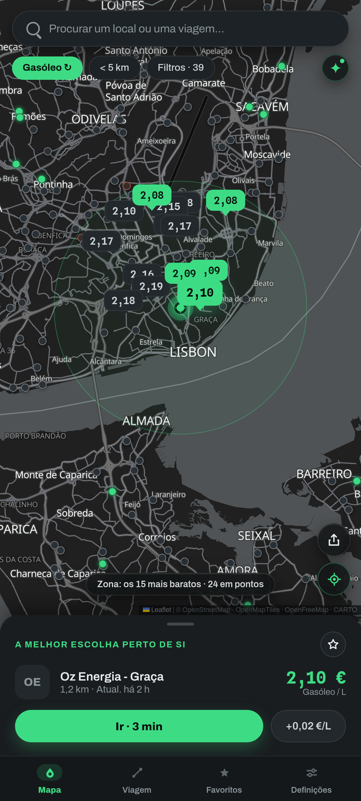
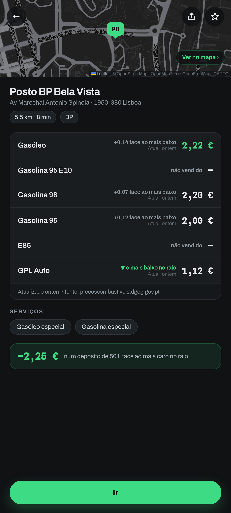
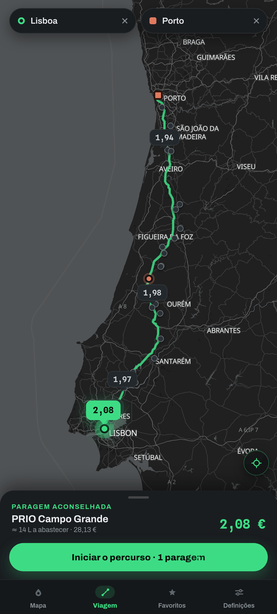
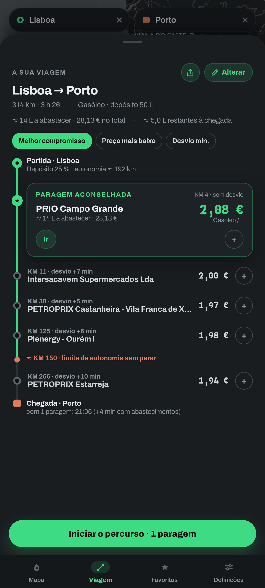

# Plein.

**O depósito cheio ao preço justo** — encontre os postos de combustível mais
baratos à sua volta e ao longo dos seus trajetos, em França, Espanha, Andorra e Portugal.

[English](README.md) · [Français](README.fr.md) · [Español](README.es.md) · [Català](README.ca.md) · **Português**

 

  
  
  
  

Capturas no tema escuro. Também há um tema claro, e a cor de destaque escolhe-se em Definições › Aparência.

## ✨ Funcionalidades

- 🗺️ **Mapa de preços em direto**: os postos à sua volta, com alfinetes coloridos do mais barato (verde) ao mais caro (laranja).
- 🇫🇷🇪🇸🇦🇩🇵🇹 **Quatro países, um só mapa**: os fluxos oficiais de França, Espanha, Andorra e Portugal, para comparar num relance os abastecimentos junto à fronteira.
- 📋 **A verdadeira melhor escolha**: o combustível gasto no desvio conta, por isso um posto mais próximo pode bater o mais barato.
- 🛣️ **Um plano de abastecimento para a viagem**: onde parar, quantos litros e a que preço, com três estratégias, e quanto sobra à chegada.
- 🔎 **Pesquisa de locais**: cidades, moradas e pontos de interesse nos quatro países.
- ⛽ **Todos os combustíveis, todos os filtros**: Gasóleo, SP95/98, E10, E85 e GPL, filtrados por raio, marca, serviços e AdBlue.
- 🏷️ **Marcas e horários reais**: nomes e logótipos dos dados oficiais e do OpenStreetMap, horários de abertura, bombas em rutura e a frescura dos preços.
- ⭐ **Favoritos e ligações**: os seus postos ao preço do dia, e cada mapa ou trajeto reabre a partir do seu endereço.
- 📱 **Em qualquer lado**: telemóvel ou computador, instalável e utilizável offline, tema claro e escuro, cinco línguas.

## 🚀 Utilização

1. Abra **[plein.zadkiel.fr](https://plein.zadkiel.fr)**. Autorize a localização ou procure uma cidade.
2. Escolha o combustível: a melhor escolha aparece primeiro, e **Ir** abre-a na sua app de mapas.
3. Para uma viagem, abra **Viagem** e introduza o destino. **Iniciar o percurso** passa o itinerário ao Google Maps, paragens para abastecer incluídas.
4. No telemóvel, instale a app (a faixa de instalação, ou Definições › Aplicação) para a ter em ecrã inteiro e offline.

Sem conta, sem rastreadores: os seus favoritos e definições ficam no seu navegador.

Quer ver o que vem a seguir? [staging-plein.zadkiel.workers.dev](https://staging-plein.zadkiel.workers.dev) serve o último `main` antes de ser publicado, e pode falhar.

## 📊 Fontes de dados

Cada país traz os seus próprios fluxos oficiais de preços e de geocodificação, escolhidos consoante a zona no ecrã (a fonte *Automático*). Os itinerários e o mapa base são comuns.

### 🇫🇷 França

| Dado | Fonte | Licença |
| --- | --- | --- |
| Preços dos combustíveis e horários | [Prix des carburants, fluxo em tempo real](https://data.economie.gouv.fr/explore/dataset/prix-des-carburants-en-france-flux-instantane-v2/) (data.economie.gouv.fr) | Licence Ouverte / Open Licence |
| Marcas dos postos | [OpenStreetMap](https://www.openstreetmap.org/) (índice estático gerado, associado aos postos por proximidade) | ODbL |
| Geocodificação e preenchimento automático | [Base Adresse Nationale](https://adresse.data.gouv.fr/), através do serviço de geocodificação da Géoplateforme (data.geopf.fr) | Licence Ouverte / Open Licence |
| Pontos de interesse (aeroportos, estações de comboio, monumentos…) | [Serviço de geocodificação da Géoplateforme](https://geoservices.ign.fr/documentation/services/services-geoplateforme/geocodage) (data.geopf.fr, BD TOPO do IGN) | Licence Ouverte / Open Licence |
| Geocodificação de recurso, quando a Géoplateforme não responde | [Photon](https://photon.komoot.io) (instância pública da Komoot, índice OpenStreetMap), limitado à França metropolitana | ODbL |

### 🇪🇸 Espanha

| Dado | Fonte | Licença |
| --- | --- | --- |
| Preços dos combustíveis, horários e marcas | [Precios de carburantes](https://geoportalgasolineras.es) (sedeaplicaciones.minetur.gob.es, MITECO); a marca (*rótulo*) vem no fluxo | Datos abiertos |
| Geocodificação e preenchimento automático | [CartoCiudad](https://www.cartociudad.es) (IGN) | CC BY 4.0 |
| Geocodificação de recurso, quando o CartoCiudad não responde | [Photon](https://photon.komoot.io), limitado à Espanha peninsular e às Baleares | ODbL |

### 🇦🇩 Andorra

| Dado | Fonte | Licença |
| --- | --- | --- |
| Preços dos combustíveis e marcas | [Preus dels carburants](https://sig.govern.ad/IPE/PreusCarburants) (sig.govern.ad, Govern d'Andorra, Oficina de l'Energia i del Canvi Climàtic); a marca vem do nome do posto, e o fluxo não traz morada nem horários | © Govern d'Andorra |
| Geocodificação e preenchimento automático | Nomenclàtor (dicionário geográfico oficial) & LocatorIDE (sig.govern.ad, IDE Andorra) | © Govern d'Andorra |
| Geocodificação de recurso, quando os localizadores da IDE não respondem | [Photon](https://photon.komoot.io), limitado a Andorra | ODbL |

### 🇵🇹 Portugal

| Dado | Fonte | Licença |
| --- | --- | --- |
| Preços dos combustíveis e marcas | [Preços dos combustíveis](https://precoscombustiveis.dgeg.gov.pt) (DGEG, Direção-Geral de Energia e Geologia); o fluxo traz a marca (*marca*) mas não os horários nem o E10, e cobre apenas o continente (os Açores e a Madeira têm o seu próprio regime) | Dados abertos |
| Geocodificação e preenchimento automático | [Photon](https://photon.komoot.io) (instância pública da Komoot, índice OpenStreetMap), limitado a Portugal continental (o país não publica nenhum geocodificador de moradas sem chave) | ODbL |

### Comuns aos quatro países

| Dado | Fonte | Licença |
| --- | --- | --- |
| Cálculo de itinerários | [OSRM](https://project-osrm.org/) (servidor de demonstração) · [Valhalla](https://valhalla.github.io/valhalla/) (servidor público FOSSGIS) para «evitar autoestradas / portagens» | © colaboradores do [OpenStreetMap](https://www.openstreetmap.org/copyright) |
| Mapas base | Mosaicos vetoriais do [OpenFreeMap](https://openfreemap.org), sem chave de API, estilo Positron / Dark Matter consoante o tema (mosaicos raster do OpenStreetMap como recurso se o OpenFreeMap não responder ou o dispositivo não tiver WebGL) | © [OpenMapTiles](https://openmaptiles.org) · © colaboradores do [OpenStreetMap](https://www.openstreetmap.org/copyright) · cores do estilo escuro © [CARTO](https://carto.com/attributions) (CC BY 4.0) |

A app não tem **nenhum backend**: o navegador consulta diretamente estes serviços públicos. Sem ligação ou com um fluxo indisponível, mantém os últimos postos carregados com uma faixa que o indica, e tenta de novo assim que a ligação volta. Quando o geocodificador de um país não responde, o Photon substitui-o; se também falhar, a pesquisa indica que países faltam.

## 🛠️ Construído com

**Vite · React 18 · TypeScript estrito · Leaflet**, mais o MapLibre GL para o mapa base vetorial (carregado a pedido). O build de produção são recursos estáticos servidos por um Cloudflare Worker.

## 🤝 Contribuir

Relatos de erros, traduções e pull requests são bem-vindos: [CONTRIBUTING.md](CONTRIBUTING.md) (em inglês) explica a instalação, os comandos, as regras da casa e os testes. Ao comunicar um erro, inclua o instantâneo de depuração: Definições › Dados offline › Sobreposição de depuração, depois a pastilha flutuante **DBG** › **Report**, que o copia e abre o formulário.

## 📄 Licença

Código sob licença [MIT](LICENSE) © Zadkiel Aharonian. Os dados apresentados continuam sujeitos às licenças dos respetivos produtores (Licence Ouverte para os dados públicos franceses, datos abiertos do MITECO para os preços espanhóis, © Govern d'Andorra para Andorra, dados abertos da DGEG para os preços portugueses, ODbL para o OpenStreetMap). Os tipos de letra **Archivo** e **Spline Sans Mono**, em `public/fonts/`, estão sob a [SIL Open Font License 1.1](public/fonts/) (ver os ficheiros `*-OFL.txt` dessa pasta).
